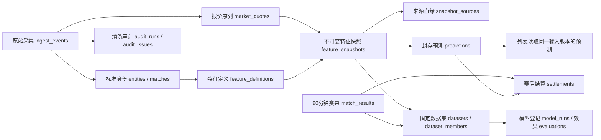
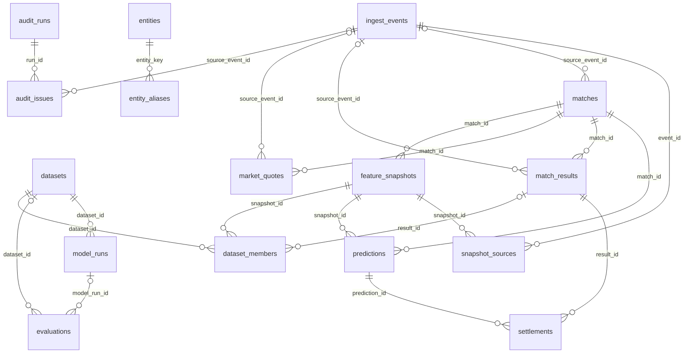

# 独立研究与特征库：完整数据结构

数据库：`football_research`；迁移版本：`001`。

本文从真实 MySQL 的 information_schema 生成，包含全部表、字段、索引和外键。表中不包含连接凭据。

## 数据链路与边界



- 业务库保持原有读写；本流程只读业务库，研究事实写入独立库。运行时连接不执行DDL。
- 源北京时间赛程日与UTC时间戳分开保存；没有来源依据的时间保持未知。
- `reconstructed`：对历史的当前数据重建，不冒充当时的赛前预测。
- `live`：实际采集事件，或开赛前封存的本地可用输入。仍需结合 source、quality、quality_flags 判断源报价时点及完整性；不等于真实资金流，也不等于所有来源时间已确认。
- 快照缺失值为NULL，真实零值保留。训练中位数仅在原模型推理时使用，不写回清洗数据。
- `values_json`用于数值查询，遵循MySQL JSON的浮点序列化格式。精确输入证据保存在`ingest_events.payload`二进制原文中；模型重放从该原文按固定计算版本重建，并核对分数与决定。
- 相同输入版本保留首次快照；输入改变形成新版本。预测不可覆盖，赛后追加标签和结算。
- 本地大原文按内容去重；真实HTTP观察按实际接收时间追加。同步批次与固定数据集记录本次引用的快照版本。
- 后续同步先核对原始数据与计算代码的完整内容指纹；未变化时沿用已封存版本，不重新计算全部特征。
- 真实赛前效果按每场第一份有效赛前预测评估，一场只计一次；未完赛不进入命中率分母。历史重建另行统计。
- 当前比分方法 `draw-score-baseline-v1`：仅二次保留竞彩推荐1:1和0:0，赛果仅用于事后核验，没有声称比分概率已校准。
- 列表接管版本`research-takeover-v1`：按当前输入内容指纹、模型/特征/规则/比分版本精确读取预测；无匹配时计算一次并封存回读。不会把真实赛前评估的第一份预测直接替换最新输入结果。
- 原模型及二次0.225独立于比分推荐。研究库故障时保留原计算结果，并明确标记回退；来源正常的日缓存可长期复用，旧日缓存按日升级，回退缓存短期重试。
- 首选与前二命中分别统计，分母是实际推荐且已确认常规时间赛果的比赛；评估核对当时保存的有序比分数组，不硬编码只命中0:0/1:1。

## 表关系全貌



## 全部表

| 表 | 分层 | 用途 |
|---|---|---|
| `audit_issues` | 质量审计 | 异常隔离与原因审计清单 |
| `audit_runs` | 质量审计 | 每次清洗审计运行登记 |
| `dataset_members` | 学习评估 | 数据集固定比赛和输入标签成员 |
| `datasets` | 学习评估 | 训练校准测试数据集的固定版本 |
| `entities` | 标准数据 | 标准球队与联赛身份字典 |
| `entity_aliases` | 标准数据 | 外部身份和名称映射禁止歧义合并 |
| `evaluations` | 学习评估 | 各版本各人群的可复现效果记录 |
| `feature_definitions` | 特征 | 公式单位依赖及缺失策略版本字典 |
| `feature_snapshots` | 特征 | 截止时点特征原始缺失及质量的不可变快照 |
| `ingest_events` | 原始证据 | 原始响应追加档案禁止覆盖 |
| `market_quotes` | 标准数据 | 公司玩法阶段分离的不可变报价事件 |
| `match_results` | 结果标签 | 常规加时点球分离的赛果追加版本 |
| `matches` | 标准数据 | 标准赛事实体当前索引原证据由事件留存 |
| `model_runs` | 学习评估 | 候选与既有模型的版本工件登记 |
| `predictions` | 预测结算 | 原二次增强与双比分决定的封存记录 |
| `schema_migrations` | 治理 | 研究库版本迁移记录 |
| `settlements` | 预测结算 | 赛后追加结算不改写原预测 |
| `snapshot_sources` | 特征 | 每份特征的原始数据血缘 |

## audit_issues · 质量问题明细

异常隔离与原因审计清单

| 字段 | MySQL类型 | 允许NULL | 主键 | 说明 |
|---|---|---|---|---|
| `id` | `bigint` | 否 | 是 | 质量问题ID |
| `issue_hash` | `char(64)` | 否 |  | 同批次问题幂等指纹 |
| `run_id` | `bigint` | 否 |  | 所属审计批次 |
| `match_id` | `varchar(64)` | 否 |  | 相关比赛ID空为全局问题 |
| `source_event_id` | `bigint` | 是 |  | 相关原始事件ID |
| `severity` | `varchar(32)` | 否 |  | info或warning或error |
| `code` | `varchar(100)` | 否 |  | 稳定质量问题代码 |
| `field_name` | `varchar(190)` | 否 |  | 问题字段或输入组 |
| `message` | `text` | 否 |  | 可读问题说明 |
| `detail` | `json` | 否 |  | 原值修正值及处理依据 |
| `status` | `varchar(32)` | 否 |  | 待处理或已标记解决 |
| `created_at` | `datetime(6)` | 否 |  | 问题记录时间UTC |

索引：

- `fk_issue_source`：`(source_event_id)`。
- `ix_audit_issue_batch`：`(run_id, severity, status)`。
- `ix_audit_issue_match`：`(match_id, status)`。
- `PRIMARY`：唯一；`(id)`。
- `uq_audit_issue`：唯一；`(issue_hash)`。

外键：

- `run_id` → `audit_runs.id`。
- `source_event_id` → `ingest_events.id`。

## audit_runs · 清洗审计批次

每次清洗审计运行登记

| 字段 | MySQL类型 | 允许NULL | 主键 | 说明 |
|---|---|---|---|---|
| `id` | `bigint` | 否 | 是 | 清洗审计批次ID |
| `kind` | `varchar(64)` | 否 |  | 审计任务种类 |
| `version` | `varchar(100)` | 否 |  | 审计规则版本 |
| `started_at` | `datetime(6)` | 否 |  | 开始时间UTC |
| `finished_at` | `datetime(6)` | 是 |  | 完成时间UTC |
| `status` | `varchar(32)` | 否 |  | running或completed或failed |
| `metadata` | `json` | 否 |  | 范围源版本与运行结果摘要 |

索引：

- `ix_audit_run_time`：`(started_at, status)`。
- `PRIMARY`：唯一；`(id)`。

## dataset_members · 数据集样本与切分

数据集固定比赛和输入标签成员

| 字段 | MySQL类型 | 允许NULL | 主键 | 说明 |
|---|---|---|---|---|
| `dataset_id` | `bigint` | 否 | 是 | 所属固定数据集 |
| `snapshot_id` | `bigint` | 否 | 是 | 具体不可变输入快照 |
| `result_id` | `bigint` | 是 |  | 标签赛果版本无标签为NULL |
| `split_name` | `varchar(32)` | 否 |  | train或calibration或test或research或prospective赛前无标签 |

索引：

- `fk_member_result`：`(result_id)`。
- `fk_member_snapshot`：`(snapshot_id)`。
- `ix_dataset_split`：`(dataset_id, split_name)`。
- `PRIMARY`：唯一；`(dataset_id, snapshot_id)`。

外键：

- `dataset_id` → `datasets.id`。
- `result_id` → `match_results.id`。
- `snapshot_id` → `feature_snapshots.id`。

## datasets · 固定数据集

训练校准测试数据集的固定版本

| 字段 | MySQL类型 | 允许NULL | 主键 | 说明 |
|---|---|---|---|---|
| `id` | `bigint` | 否 | 是 | 固定数据集ID |
| `name` | `varchar(100)` | 否 |  | 数据集用途名称 |
| `version` | `varchar(100)` | 否 |  | 不可变数据集版本 |
| `feature_version` | `varchar(100)` | 否 |  | 使用的特征版本 |
| `manifest_hash` | `char(64)` | 否 |  | 数据清单内容哈希 |
| `manifest` | `json` | 否 |  | 选择口径时间切分及排除原因 |
| `created_at` | `datetime(6)` | 否 |  | 创建时间UTC |

索引：

- `PRIMARY`：唯一；`(id)`。
- `uq_dataset_version`：唯一；`(name, version)`。

## entities · 球队联赛身份

标准球队与联赛身份字典

| 字段 | MySQL类型 | 允许NULL | 主键 | 说明 |
|---|---|---|---|---|
| `entity_key` | `varchar(100)` | 否 | 是 | 标准实体键含类型前缀 |
| `entity_type` | `varchar(32)` | 否 |  | team球队或league联赛 |
| `name` | `varchar(255)` | 否 |  | 标准展示名称 |
| `source` | `varchar(64)` | 否 |  | 身份来源 |
| `external_id` | `varchar(100)` | 否 |  | 来源原始实体ID |
| `metadata` | `json` | 否 |  | 可追溯映射附加信息 |
| `updated_at` | `datetime(6)` | 否 |  | 标准映射更新时间UTC |

索引：

- `ix_entity_source`：`(source, entity_type, external_id)`。
- `PRIMARY`：唯一；`(entity_key)`。

## entity_aliases · 来源身份映射

外部身份和名称映射禁止歧义合并

| 字段 | MySQL类型 | 允许NULL | 主键 | 说明 |
|---|---|---|---|---|
| `id` | `bigint` | 否 | 是 | 身份别名记录ID |
| `entity_key` | `varchar(100)` | 否 |  | 对应标准实体键 |
| `source` | `varchar(64)` | 否 |  | 外部来源 |
| `external_id` | `varchar(100)` | 否 |  | 该来源实体ID可为空 |
| `alias` | `varchar(255)` | 否 |  | 原始名称别名 |
| `confidence` | `varchar(32)` | 否 |  | ID精确或无歧义名称等匹配等级 |
| `mapping_hash` | `char(64)` | 否 |  | 映射内容幂等指纹 |
| `created_at` | `datetime(6)` | 否 |  | 映射创建时间UTC |

索引：

- `ix_alias_entity`：`(entity_key)`。
- `ix_alias_lookup`：`(source, external_id)`。
- `PRIMARY`：唯一；`(id)`。
- `uq_alias_hash`：唯一；`(mapping_hash)`。

外键：

- `entity_key` → `entities.entity_key`。

## evaluations · 版本效果评估

各版本各人群的可复现效果记录

| 字段 | MySQL类型 | 允许NULL | 主键 | 说明 |
|---|---|---|---|---|
| `id` | `bigint` | 否 | 是 | 评估结果ID |
| `evaluation_hash` | `char(64)` | 否 |  | 评估内容幂等指纹 |
| `model_run_id` | `bigint` | 是 |  | 对应模型运行ID |
| `dataset_id` | `bigint` | 是 |  | 评估使用的固定数据集ID |
| `version` | `varchar(100)` | 否 |  | 评估逻辑版本 |
| `scope` | `varchar(100)` | 否 |  | 原模型二选增强比分等范围 |
| `metrics` | `json` | 否 |  | 分母明确的命中覆盖样本数等指标 |
| `created_at` | `datetime(6)` | 否 |  | 实际评估时间UTC |

索引：

- `fk_evaluation_dataset`：`(dataset_id)`。
- `fk_evaluation_model`：`(model_run_id)`。
- `ix_evaluation_scope`：`(scope, created_at)`。
- `PRIMARY`：唯一；`(id)`。
- `uq_evaluation_hash`：唯一；`(evaluation_hash)`。

外键：

- `dataset_id` → `datasets.id`。
- `model_run_id` → `model_runs.id`。

## feature_definitions · 特征定义字典

公式单位依赖及缺失策略版本字典

| 字段 | MySQL类型 | 允许NULL | 主键 | 说明 |
|---|---|---|---|---|
| `id` | `bigint` | 否 | 是 | 特征定义ID |
| `feature_version` | `varchar(100)` | 否 |  | 整套特征定义版本 |
| `feature_name` | `varchar(190)` | 否 |  | 稳定唯一特征名称 |
| `value_type` | `varchar(32)` | 否 |  | 数值或布尔等类型 |
| `unit` | `varchar(64)` | 否 |  | 单位或比例口径 |
| `description` | `text` | 否 |  | 特征业务解释 |
| `formula` | `text` | 否 |  | 具体计算依据或表达式 |
| `origin` | `varchar(64)` | 否 |  | 原始真实或本地推算模拟来源类别 |
| `missing_policy` | `text` | 否 |  | 缺失处理及样本门槛 |
| `code_hash` | `varchar(100)` | 否 |  | 计算代码或模型定义哈希 |
| `metadata` | `json` | 否 |  | 依赖字段和有效性门槛等完整元数据 |
| `definition_hash` | `char(64)` | 否 |  | 定义不可变内容指纹 |
| `created_at` | `datetime(6)` | 否 |  | 注册时间UTC |

索引：

- `PRIMARY`：唯一；`(id)`。
- `uq_feature_version_name`：唯一；`(feature_version, feature_name)`。

## feature_snapshots · 不可变特征快照

截止时点特征原始缺失及质量的不可变快照

| 字段 | MySQL类型 | 允许NULL | 主键 | 说明 |
|---|---|---|---|---|
| `id` | `bigint` | 否 | 是 | 不可变特征快照ID |
| `snapshot_hash` | `char(64)` | 否 |  | 输入版本与质量内容指纹不含重复采集时间 |
| `match_id` | `varchar(64)` | 否 |  | 目标比赛ID |
| `as_of` | `datetime(6)` | 否 |  | 这份输入声称的预测截止时间UTC |
| `kickoff` | `datetime(6)` | 否 |  | 封存时目标开球时间UTC |
| `feature_version` | `varchar(100)` | 否 |  | 所用特征公式版本 |
| `data_revision` | `varchar(100)` | 否 |  | 原始数据批次或重建版本 |
| `provenance` | `varchar(32)` | 否 |  | live真实赛前或reconstructed历史重建 |
| `known_by` | `datetime(6)` | 是 |  | 全部依赖真实已知时间上界未知为NULL |
| `quality` | `varchar(64)` | 否 |  | 样本质量等级 |
| `values_json` | `json` | 否 |  | 仅预测输入不含本场赛果 |
| `missing_json` | `json` | 否 |  | 原始缺失字段及位图保留插补前状态 |
| `quality_flags` | `json` | 否 |  | 时间身份缺失取样等审计标记 |
| `created_at` | `datetime(6)` | 否 |  | 实际封存时间UTC |

索引：

- `ix_snapshot_match`：`(match_id, as_of)`。
- `ix_snapshot_scope`：`(feature_version, provenance, as_of)`。
- `PRIMARY`：唯一；`(id)`。
- `uq_snapshot_hash`：唯一；`(snapshot_hash)`。
- `uq_snapshot_revision`：唯一；`(match_id, feature_version, data_revision)`。

外键：

- `match_id` → `matches.match_id`。

## ingest_events · 原始采集档案

原始响应追加档案禁止覆盖

| 字段 | MySQL类型 | 允许NULL | 主键 | 说明 |
|---|---|---|---|---|
| `id` | `bigint` | 否 | 是 | 原始采集事件ID |
| `event_hash` | `char(64)` | 否 |  | 来源及接收时点及原文的幂等指纹 |
| `payload_hash` | `char(64)` | 否 |  | 原始响应SHA256 |
| `source` | `varchar(64)` | 否 |  | 来源服务 |
| `kind` | `varchar(64)` | 否 |  | 响应种类 |
| `match_id` | `varchar(64)` | 否 |  | 源比赛ID或空值代表批量赛程 |
| `observed_at` | `datetime(6)` | 否 |  | 系统真实收到原文的时间UTC |
| `source_at` | `datetime(6)` | 是 |  | 来源声明的变动时间UTC未知为NULL |
| `provenance` | `varchar(32)` | 否 |  | live真实采集或reconstructed旧库重建 |
| `parser_version` | `varchar(100)` | 否 |  | 采集解析代码版本 |
| `request_url` | `text` | 否 |  | 去除敏感查询后的来源地址 |
| `http_status` | `int` | 否 |  | 实际HTTP状态未知为0 |
| `payload` | `longblob` | 否 |  | 未经清洗的原始响应字节允许非JSON及非UTF8 |
| `created_at` | `datetime(6)` | 否 |  | 档案落库时间UTC |

索引：

- `ix_ingest_local_content`：`(source, kind, match_id, payload_hash, provenance, parser_version, observed_at, id)`。
- `ix_ingest_match_kind_time`：`(match_id, kind, observed_at)`。
- `ix_ingest_payload`：`(payload_hash)`。
- `ix_ingest_source_time`：`(source, observed_at)`。
- `PRIMARY`：唯一；`(id)`。
- `uq_ingest_event`：唯一；`(event_hash)`。

## market_quotes · 公司盘口报价事件

公司玩法阶段分离的不可变报价事件

| 字段 | MySQL类型 | 允许NULL | 主键 | 说明 |
|---|---|---|---|---|
| `id` | `bigint` | 否 | 是 | 报价事件ID |
| `quote_hash` | `char(64)` | 否 |  | 报价全部内容的幂等指纹 |
| `match_id` | `varchar(64)` | 否 |  | 标准比赛ID |
| `company` | `varchar(64)` | 否 |  | 明确公司标识 |
| `market_type` | `varchar(32)` | 否 |  | euro亚盘asian或大小球goals等玩法 |
| `phase` | `varchar(32)` | 否 |  | opening初盘或latest即时或tick变动 |
| `source_event_id` | `bigint` | 是 |  | 所属原始响应事件 |
| `source_at` | `datetime(6)` | 是 |  | 报价来源时点未知为NULL |
| `observed_at` | `datetime(6)` | 否 |  | 系统实际获得报价时间UTC |
| `provenance` | `varchar(32)` | 否 |  | 真实采集或历史重建 |
| `home_value` | `decimal(22,10)` | 是 |  | 主胜赔率或明确主方向数值缺失为NULL |
| `draw_value` | `decimal(22,10)` | 是 |  | 平局赔率缺失为NULL |
| `away_value` | `decimal(22,10)` | 是 |  | 客胜赔率或明确客方向数值缺失为NULL |
| `line_value` | `decimal(22,10)` | 是 |  | 让球或大小球盘口真实0可保存 |
| `home_water` | `decimal(22,10)` | 是 |  | 主队或大球水位缺失为NULL |
| `away_water` | `decimal(22,10)` | 是 |  | 客队或小球水位缺失为NULL |
| `raw_json` | `json` | 否 |  | 来源原始盘口单行 |

索引：

- `ix_quote_asof`：`(match_id, company, market_type, observed_at)`。
- `ix_quote_source`：`(source_event_id)`。
- `PRIMARY`：唯一；`(id)`。
- `uq_quote_hash`：唯一；`(quote_hash)`。

外键：

- `match_id` → `matches.match_id`。
- `source_event_id` → `ingest_events.id`。

## match_results · 常规加时点球赛果

常规加时点球分离的赛果追加版本

| 字段 | MySQL类型 | 允许NULL | 主键 | 说明 |
|---|---|---|---|---|
| `id` | `bigint` | 否 | 是 | 赛果修订ID |
| `result_hash` | `char(64)` | 否 |  | 赛果版本的幂等指纹 |
| `match_id` | `varchar(64)` | 否 |  | 标准比赛ID |
| `home_score` | `int` | 是 |  | 常规90分钟主队进球未知为NULL |
| `away_score` | `int` | 是 |  | 常规90分钟客队进球未知为NULL |
| `extra_home` | `int` | 是 |  | 加时主队进球未知为NULL |
| `extra_away` | `int` | 是 |  | 加时客队进球未知为NULL |
| `penalty_home` | `int` | 是 |  | 点球主队进球未知为NULL |
| `penalty_away` | `int` | 是 |  | 点球客队进球未知为NULL |
| `regulation_confirmed` | `tinyint(1)` | 否 |  | 是否能确认90分钟赛果 |
| `status` | `varchar(64)` | 否 |  | 来源完赛或歧义状态 |
| `available_at` | `datetime(6)` | 是 |  | 赛果首次已知时间未知为NULL |
| `observed_at` | `datetime(6)` | 否 |  | 实际获得该赛果版本时间UTC |
| `source_event_id` | `bigint` | 是 |  | 原始赛果来源事件 |
| `provenance` | `varchar(32)` | 否 |  | 真实记录或历史重建 |

索引：

- `fk_result_source`：`(source_event_id)`。
- `ix_result_match`：`(match_id, observed_at)`。
- `PRIMARY`：唯一；`(id)`。
- `uq_result_hash`：唯一；`(result_hash)`。

外键：

- `match_id` → `matches.match_id`。
- `source_event_id` → `ingest_events.id`。

## matches · 标准比赛

标准赛事实体当前索引原证据由事件留存

| 字段 | MySQL类型 | 允许NULL | 主键 | 说明 |
|---|---|---|---|---|
| `match_id` | `varchar(64)` | 否 | 是 | 标准比赛ID沿用权威源matchId |
| `home_id` | `varchar(100)` | 否 |  | 主队来源ID缺失为空 |
| `away_id` | `varchar(100)` | 否 |  | 客队来源ID缺失为空 |
| `home_name` | `varchar(255)` | 否 |  | 主队名称 |
| `away_name` | `varchar(255)` | 否 |  | 客队名称 |
| `league_id` | `varchar(100)` | 否 |  | 联赛来源ID缺失为空 |
| `league_name` | `varchar(255)` | 否 |  | 联赛名称 |
| `schedule_date` | `date` | 否 |  | 源站北京时间赛程日不由UTC日期推导 |
| `kickoff` | `datetime(6)` | 否 |  | 真实开球时间UTC |
| `jingcai_id` | `varchar(64)` | 否 |  | 竞彩编号非竞彩为空 |
| `source_event_id` | `bigint` | 是 |  | 身份来自的原始事件 |
| `updated_at` | `datetime(6)` | 否 |  | 当前实体映射更新时间UTC |

索引：

- `fk_match_source`：`(source_event_id)`。
- `ix_matches_away`：`(away_id, kickoff)`。
- `ix_matches_day`：`(schedule_date, kickoff)`。
- `ix_matches_home`：`(home_id, kickoff)`。
- `ix_matches_jingcai`：`(jingcai_id, schedule_date)`。
- `PRIMARY`：唯一；`(match_id)`。

外键：

- `source_event_id` → `ingest_events.id`。

## model_runs · 模型工件与训练登记

候选与既有模型的版本工件登记

| 字段 | MySQL类型 | 允许NULL | 主键 | 说明 |
|---|---|---|---|---|
| `id` | `bigint` | 否 | 是 | 训练或注册模型运行ID |
| `version` | `varchar(100)` | 否 |  | 模型工件版本 |
| `dataset_id` | `bigint` | 否 |  | 采用的数据集版本 |
| `artifact_hash` | `varchar(100)` | 否 |  | 模型工件SHA256 |
| `artifact_uri` | `text` | 否 |  | 工件文件位置不存大文件到Git |
| `config` | `json` | 否 |  | 训练配置及特征版本 |
| `status` | `varchar(32)` | 否 |  | candidate或rejected或registered |
| `started_at` | `datetime(6)` | 否 |  | 训练或登记时间UTC |

索引：

- `fk_model_dataset`：`(dataset_id)`。
- `PRIMARY`：唯一；`(id)`。
- `uq_model_run`：唯一；`(version, dataset_id, artifact_hash)`。

外键：

- `dataset_id` → `datasets.id`。

## predictions · 封存模型与双比分预测

原二次增强与双比分决定的封存记录

| 字段 | MySQL类型 | 允许NULL | 主键 | 说明 |
|---|---|---|---|---|
| `id` | `bigint` | 否 | 是 | 不可变预测ID |
| `prediction_hash` | `char(64)` | 否 |  | 预测内容指纹 |
| `snapshot_id` | `bigint` | 否 |  | 输入快照ID |
| `match_id` | `varchar(64)` | 否 |  | 目标比赛ID |
| `model_version` | `varchar(100)` | 否 |  | 冻结模型版本 |
| `rule_version` | `varchar(100)` | 否 |  | 二选及增强规则版本 |
| `predicted_at` | `datetime(6)` | 否 |  | 实际生成预测时间UTC |
| `state` | `varchar(64)` | 否 |  | 原模型入选状态 |
| `score` | `double` | 是 |  | 原模型分数并非已校准概率 |
| `threshold_value` | `double` | 是 |  | 原模型固定门槛 |
| `secondary_selected` | `tinyint(1)` | 否 |  | 二次筛选是否保留 |
| `enhanced` | `tinyint(1)` | 否 |  | 是否盈亏分歧增强 |
| `score_method` | `varchar(100)` | 否 |  | 双比分计算版本 |
| `scorelines` | `json` | 否 |  | 两个推荐比分及说明不含本场赛果 |
| `payload` | `json` | 否 |  | 完整模型决定及推断说明 |
| `created_at` | `datetime(6)` | 否 |  | 预测写入时间UTC |

索引：

- `ix_prediction_match`：`(match_id, predicted_at)`。
- `ix_prediction_scope`：`(model_version, secondary_selected, predicted_at)`。
- `PRIMARY`：唯一；`(id)`。
- `uq_prediction_revision`：唯一；`(snapshot_id, model_version, rule_version, score_method)`。

外键：

- `match_id` → `matches.match_id`。
- `snapshot_id` → `feature_snapshots.id`。

## schema_migrations · 数据库版本

研究库版本迁移记录

| 字段 | MySQL类型 | 允许NULL | 主键 | 说明 |
|---|---|---|---|---|
| `version` | `varchar(32)` | 否 | 是 | 不可变迁移版本 |
| `checksum` | `char(64)` | 否 |  | 迁移SQL的SHA256 |
| `applied_at` | `datetime(6)` | 否 |  | 实际执行时间UTC |

索引：

- `PRIMARY`：唯一；`(version)`。

## settlements · 赛后结算

赛后追加结算不改写原预测

| 字段 | MySQL类型 | 允许NULL | 主键 | 说明 |
|---|---|---|---|---|
| `id` | `bigint` | 否 | 是 | 结算记录ID |
| `prediction_id` | `bigint` | 否 |  | 原预测ID |
| `result_id` | `bigint` | 否 |  | 本次采用的真实赛果版本 |
| `is_draw` | `tinyint(1)` | 否 |  | 是否常规平局 |
| `scoreline_hit` | `tinyint(1)` | 否 |  | 是否命中两个推荐比分之一 |
| `settled_at` | `datetime(6)` | 否 |  | 实际结算时间UTC |

索引：

- `fk_settlement_result`：`(result_id)`。
- `PRIMARY`：唯一；`(id)`。
- `uq_settlement_revision`：唯一；`(prediction_id, result_id)`。

外键：

- `prediction_id` → `predictions.id`。
- `result_id` → `match_results.id`。

## snapshot_sources · 特征来源血缘

每份特征的原始数据血缘

| 字段 | MySQL类型 | 允许NULL | 主键 | 说明 |
|---|---|---|---|---|
| `snapshot_id` | `bigint` | 否 | 是 | 特征快照ID |
| `event_id` | `bigint` | 否 | 是 | 实际依赖的原始事件ID |

索引：

- `fk_ss_event`：`(event_id)`。
- `PRIMARY`：唯一；`(snapshot_id, event_id)`。

外键：

- `event_id` → `ingest_events.id`。
- `snapshot_id` → `feature_snapshots.id`。

## 初始化、同步与查看

在 `go_server` 目录执行有限维护命令（不会监听端口或启停服务）：

```powershell
go run ./cmd/research-store -action init
go run ./cmd/research-store -action sync
go run ./cmd/research-store -action overview
go run ./cmd/research-store -action takeover -out "$env:TEMP/peak-ball-research-takeover-verification.json"
go run ./cmd/research-store -action takeover-inspect -date 2026-10-24 -out "$env:TEMP/peak-ball-research-takeover-response.json"
go run ./cmd/research-store -action schema -out "$env:TEMP/peak-ball-research-overview.json"
```

运行连接参数：`RESEARCH_BASE_DSN` 默认沿用业务连接配置；`RESEARCH_DB_NAME` 默认 `football_research`。目标拒绝业务库和系统库。

后台路径：`/statistics/research-store`。API与后台服务加载新代码后可查看真实结构、质量分层及同步状态。程序由用户自行重启。

API进程中的同步间隔默认15分钟；`RESEARCH_SYNC_INTERVAL=0`关闭定期同步。同步通过MySQL互斥锁避免与维护命令并发，数据已封存版本不会被覆盖。

爬虫研究写入失败时，原始响应写入本地outbox，重放保留原接收时间。目录由 `RESEARCH_INGEST_OUTBOX` 指定，默认 `data/research-ingest-pending`，已从Git排除。

数据库数据、采集原文和训练样本不提交Git；代码、DDL迁移、特征字典和本文保留在仓库。数据库与outbox应纳入正常备份。
